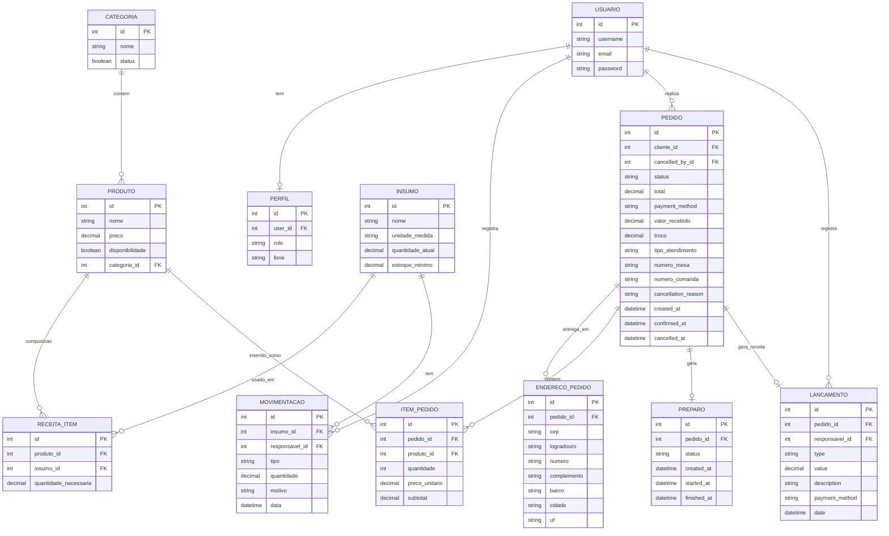

# Diagrama Entidade-Relacionamento (DER)

O diagrama abaixo ilustra as entidades principais do TCC ERP e seus relacionamentos:



---

## Scripts SQL de Criação do Banco de Dados (PostgreSQL DDL)

Abaixo estão as queries DDL completas utilizadas na estrutura do banco de dados, organizadas por módulo.

### 1. Módulo de Usuários, Perfis e Autenticação

```sql
-- Tabela principal de usuários (Admin, Atendente, Cozinheiro, Cliente)
CREATE TABLE IF NOT EXISTS public.auth_user (
    id SERIAL PRIMARY KEY,
    password VARCHAR(128) NOT NULL,
    last_login TIMESTAMP WITH TIME ZONE NULL,
    is_superuser BOOLEAN NOT NULL DEFAULT FALSE,
    username VARCHAR(150) NOT NULL UNIQUE,
    first_name VARCHAR(150) NOT NULL DEFAULT '',
    last_name VARCHAR(150) NOT NULL DEFAULT '',
    email VARCHAR(254) NOT NULL DEFAULT '',
    is_staff BOOLEAN NOT NULL DEFAULT FALSE,
    is_active BOOLEAN NOT NULL DEFAULT TRUE,
    date_joined TIMESTAMP WITH TIME ZONE NOT NULL DEFAULT CURRENT_TIMESTAMP
);

-- Perfil estendido com papel (role) e telefone
CREATE TABLE IF NOT EXISTS public.users_perfil (
    id BIGSERIAL PRIMARY KEY,
    role VARCHAR(20) NOT NULL DEFAULT 'atendente', -- 'admin', 'atendente', 'cozinha', 'cliente'
    fone VARCHAR(20) NOT NULL DEFAULT '',
    user_id INTEGER NOT NULL UNIQUE,
    CONSTRAINT users_perfil_user_id_fk FOREIGN KEY (user_id) 
        REFERENCES public.auth_user(id) ON DELETE CASCADE DEFERRABLE INITIALLY DEFERRED
);
```

### 2. Módulo de Catálogo e Cardápio

```sql
-- Categorias de Produtos (Lanches, Bebidas, Pasteis, etc.)
CREATE TABLE IF NOT EXISTS public.catalog_categoria (
    id BIGSERIAL PRIMARY KEY,
    nome VARCHAR(100) NOT NULL UNIQUE,
    descricao TEXT NOT NULL DEFAULT '',
    status BOOLEAN NOT NULL DEFAULT TRUE
);

-- Produtos comercializados no cardápio
CREATE TABLE IF NOT EXISTS public.catalog_produto (
    id BIGSERIAL PRIMARY KEY,
    nome VARCHAR(150) NOT NULL,
    descricao TEXT NOT NULL DEFAULT '',
    preco NUMERIC(10, 2) NOT NULL,
    disponibilidade BOOLEAN NOT NULL DEFAULT TRUE,
    categoria_id BIGINT NOT NULL,
    CONSTRAINT catalog_produto_categoria_id_fk FOREIGN KEY (categoria_id) 
        REFERENCES public.catalog_categoria(id) DEFERRABLE INITIALLY DEFERRED
);
```

### 3. Módulo de Estoque e Fichas Técnicas (Inventory)

```sql
-- Insumos e matérias-primas (Carne, Queijo, Farinha, etc.)
CREATE TABLE IF NOT EXISTS public.inventory_insumo (
    id BIGSERIAL PRIMARY KEY,
    nome VARCHAR(150) NOT NULL,
    unidade_medida VARCHAR(20) NOT NULL, -- 'kg', 'g', 'l', 'ml', 'un'
    quantidade_atual NUMERIC(10, 3) NOT NULL DEFAULT 0.000,
    estoque_minimo NUMERIC(10, 3) NOT NULL DEFAULT 0.000,
    custo_unitario NUMERIC(10, 2) NOT NULL DEFAULT 0.00
);

-- Composição do Produto / Ficha Técnica (insumos consumidos por produto)
CREATE TABLE IF NOT EXISTS public.inventory_receitaitem (
    id BIGSERIAL PRIMARY KEY,
    quantidade_necessaria NUMERIC(10, 3) NOT NULL,
    insumo_id BIGINT NOT NULL,
    produto_id BIGINT NOT NULL,
    CONSTRAINT inventory_receitaitem_insumo_id_fk FOREIGN KEY (insumo_id) 
        REFERENCES public.inventory_insumo(id) DEFERRABLE INITIALLY DEFERRED,
    CONSTRAINT inventory_receitaitem_produto_id_fk FOREIGN KEY (produto_id) 
        REFERENCES public.catalog_produto(id) DEFERRABLE INITIALLY DEFERRED
);

-- Histórico de movimentações de estoque (Entrada, Saída, Ajuste, Descarte)
CREATE TABLE IF NOT EXISTS public.inventory_movimentacao (
    id BIGSERIAL PRIMARY KEY,
    tipo VARCHAR(20) NOT NULL, -- 'entrada', 'saida', 'ajuste', 'descarte'
    quantidade NUMERIC(10, 3) NOT NULL,
    motivo VARCHAR(255) NOT NULL DEFAULT '',
    data TIMESTAMP WITH TIME ZONE NOT NULL DEFAULT CURRENT_TIMESTAMP,
    insumo_id BIGINT NOT NULL,
    responsavel_id INTEGER NULL,
    CONSTRAINT inventory_movimentacao_insumo_id_fk FOREIGN KEY (insumo_id) 
        REFERENCES public.inventory_insumo(id) DEFERRABLE INITIALLY DEFERRED,
    CONSTRAINT inventory_movimentacao_responsavel_id_fk FOREIGN KEY (responsavel_id) 
        REFERENCES public.auth_user(id) DEFERRABLE INITIALLY DEFERRED
);
```

### 4. Módulo de Pedidos, Atendimento, Mesa e Comanda (Orders)

```sql
-- Pedidos realizados no caixa / balcão / mesas / delivery
CREATE TABLE IF NOT EXISTS public.orders_pedido (
    id BIGSERIAL PRIMARY KEY,
    status VARCHAR(20) NOT NULL DEFAULT 'criado', -- 'criado', 'confirmado', 'em_preparo', 'pronto', 'entregue', 'finalizado', 'cancelado', 'arquivado'
    total NUMERIC(10, 2) NOT NULL DEFAULT 0.00,
    payment_method VARCHAR(20) NOT NULL DEFAULT 'dinheiro', -- 'dinheiro', 'pix', 'cartao_credito', 'cartao_debito', 'outros'
    valor_recebido NUMERIC(10, 2) NULL,
    troco NUMERIC(10, 2) NULL,
    tipo_atendimento VARCHAR(20) NOT NULL DEFAULT 'balcao', -- 'mesa', 'balcao', 'delivery', 'retirada'
    numero_mesa VARCHAR(50) NOT NULL DEFAULT 'Balcão',
    numero_comanda VARCHAR(20) NOT NULL DEFAULT '',
    created_at TIMESTAMP WITH TIME ZONE NOT NULL DEFAULT CURRENT_TIMESTAMP,
    confirmed_at TIMESTAMP WITH TIME ZONE NULL,
    cancelled_at TIMESTAMP WITH TIME ZONE NULL,
    cancellation_reason TEXT NOT NULL DEFAULT '',
    cancelled_by_id INTEGER NULL,
    cliente_id INTEGER NULL,
    CONSTRAINT orders_pedido_cliente_id_fk FOREIGN KEY (cliente_id) 
        REFERENCES public.auth_user(id) DEFERRABLE INITIALLY DEFERRED,
    CONSTRAINT orders_pedido_cancelled_by_id_fk FOREIGN KEY (cancelled_by_id) 
        REFERENCES public.auth_user(id) DEFERRABLE INITIALLY DEFERRED
);

-- Endereço de entrega para pedidos de Delivery (relação 1:1 com Pedido)
CREATE TABLE IF NOT EXISTS public.orders_enderecopedido (
    id BIGSERIAL PRIMARY KEY,
    cep VARCHAR(9) NOT NULL,
    logradouro VARCHAR(255) NOT NULL,
    numero VARCHAR(20) NOT NULL,
    complemento VARCHAR(100) NOT NULL DEFAULT '',
    bairro VARCHAR(100) NOT NULL,
    cidade VARCHAR(100) NOT NULL,
    uf VARCHAR(2) NOT NULL,
    pedido_id BIGINT NOT NULL UNIQUE,
    CONSTRAINT orders_enderecopedido_pedido_id_fk FOREIGN KEY (pedido_id) 
        REFERENCES public.orders_pedido(id) ON DELETE CASCADE DEFERRABLE INITIALLY DEFERRED
);

-- Itens que compõem cada pedido
CREATE TABLE IF NOT EXISTS public.orders_itempedido (
    id BIGSERIAL PRIMARY KEY,
    quantidade INTEGER NOT NULL,
    preco_unitario NUMERIC(10, 2) NOT NULL,
    subtotal NUMERIC(10, 2) NOT NULL,
    pedido_id BIGINT NOT NULL,
    produto_id BIGINT NOT NULL,
    CONSTRAINT orders_itempedido_pedido_id_fk FOREIGN KEY (pedido_id) 
        REFERENCES public.orders_pedido(id) ON DELETE CASCADE DEFERRABLE INITIALLY DEFERRED,
    CONSTRAINT orders_itempedido_produto_id_fk FOREIGN KEY (produto_id) 
        REFERENCES public.catalog_produto(id) DEFERRABLE INITIALLY DEFERRED
);
```

### 5. Módulo de Cozinha e Preparo KDS (Preparation)

```sql
-- Fila de preparação de pedidos na cozinha (KDS)
CREATE TABLE IF NOT EXISTS public.preparation_preparo (
    id BIGSERIAL PRIMARY KEY,
    status VARCHAR(20) NOT NULL DEFAULT 'pendente', -- 'pendente', 'em_preparo', 'pronto', 'entregue'
    created_at TIMESTAMP WITH TIME ZONE NOT NULL DEFAULT CURRENT_TIMESTAMP,
    started_at TIMESTAMP WITH TIME ZONE NULL,
    finished_at TIMESTAMP WITH TIME ZONE NULL,
    pedido_id BIGINT NOT NULL UNIQUE,
    CONSTRAINT preparation_preparo_pedido_id_fk FOREIGN KEY (pedido_id) 
        REFERENCES public.orders_pedido(id) ON DELETE CASCADE DEFERRABLE INITIALLY DEFERRED
);
```

### 6. Módulo Financeiro e Fluxo de Caixa (Finance)

```sql
-- Categorias financeiras (Vendas, Fornecedores, Despesas Operacionais, etc.)
CREATE TABLE IF NOT EXISTS public.finance_financecategory (
    id BIGSERIAL PRIMARY KEY,
    name VARCHAR(100) NOT NULL,
    type VARCHAR(10) NOT NULL, -- 'receita', 'despesa'
    description TEXT NOT NULL DEFAULT ''
);

-- Lançamentos financeiros / Fluxo de caixa
CREATE TABLE IF NOT EXISTS public.finance_lancamento (
    id BIGSERIAL PRIMARY KEY,
    type VARCHAR(10) NOT NULL, -- 'receita', 'despesa'
    value NUMERIC(10, 2) NOT NULL,
    description VARCHAR(255) NOT NULL,
    payment_method VARCHAR(20) NOT NULL, -- 'dinheiro', 'pix', 'credito', 'debito', 'boleto'
    date TIMESTAMP WITH TIME ZONE NOT NULL DEFAULT CURRENT_TIMESTAMP,
    category_id BIGINT NULL,
    pedido_id BIGINT NULL,
    responsible_id INTEGER NULL,
    CONSTRAINT finance_lancamento_category_id_fk FOREIGN KEY (category_id) 
        REFERENCES public.finance_financecategory(id) DEFERRABLE INITIALLY DEFERRED,
    CONSTRAINT finance_lancamento_pedido_id_fk FOREIGN KEY (pedido_id) 
        REFERENCES public.orders_pedido(id) DEFERRABLE INITIALLY DEFERRED,
    CONSTRAINT finance_lancamento_responsible_id_fk FOREIGN KEY (responsible_id) 
        REFERENCES public.auth_user(id) DEFERRABLE INITIALLY DEFERRED
);
```

### 7. Índices de Otimização e Performance

```sql
CREATE INDEX IF NOT EXISTS catalog_produto_categoria_id_idx ON public.catalog_produto (categoria_id);
CREATE INDEX IF NOT EXISTS inventory_receitaitem_insumo_id_idx ON public.inventory_receitaitem (insumo_id);
CREATE INDEX IF NOT EXISTS inventory_receitaitem_produto_id_idx ON public.inventory_receitaitem (produto_id);
CREATE INDEX IF NOT EXISTS inventory_movimentacao_insumo_id_idx ON public.inventory_movimentacao (insumo_id);
CREATE INDEX IF NOT EXISTS inventory_movimentacao_responsavel_id_idx ON public.inventory_movimentacao (responsavel_id);
CREATE INDEX IF NOT EXISTS orders_pedido_cliente_id_idx ON public.orders_pedido (cliente_id);
CREATE INDEX IF NOT EXISTS orders_pedido_cancelled_by_id_idx ON public.orders_pedido (cancelled_by_id);
CREATE INDEX IF NOT EXISTS orders_pedido_status_idx ON public.orders_pedido (status);
CREATE INDEX IF NOT EXISTS orders_itempedido_pedido_id_idx ON public.orders_itempedido (pedido_id);
CREATE INDEX IF NOT EXISTS orders_itempedido_produto_id_idx ON public.orders_itempedido (produto_id);
CREATE INDEX IF NOT EXISTS preparation_preparo_status_idx ON public.preparation_preparo (status);
CREATE INDEX IF NOT EXISTS finance_lancamento_category_id_idx ON public.finance_lancamento (category_id);
CREATE INDEX IF NOT EXISTS finance_lancamento_pedido_id_idx ON public.finance_lancamento (pedido_id);
CREATE INDEX IF NOT EXISTS finance_lancamento_responsible_id_idx ON public.finance_lancamento (responsible_id);
```
